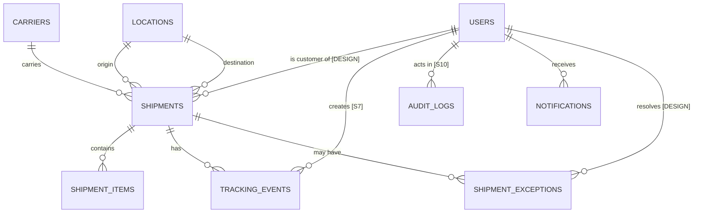

# CargoTrace — Data Model

> Base requirement: [S11]. Field-level requirements: [S6], [S7], [S8], [S9], [S10].
> Tags: `[S#]` = mandated by the brief. `[DESIGN]` = our engineering decision (must be explainable in the code interview [S11, S19]).
> **Ownership reminder [S11]:** the ERD must be authored and *explained by the student* — cardinality and design decisions are interview material. Use this document as the draft, then be able to defend every relation.

---

## 1. Entity overview (brief's minimum model [S11])

| Table | Purpose (brief wording) |
|---|---|
| `users` | akun & role |
| `shipments` | shipment utama |
| `shipment_items` | detail barang |
| `carriers` | operator logistik |
| `locations` | origin/destination |
| `tracking_events` | riwayat perjalanan |
| `shipment_exceptions` | gangguan/exception |
| `notifications` | pemberitahuan |
| `audit_logs` | jejak perubahan |

---

## 2. ERD (draft — verify and be able to explain)

**Cardinality rationale (to explain at the interview):**
- `users 1—N shipments`: a customer owns many shipments; each shipment belongs to exactly one customer account [S11, S5].
- `locations 1—N shipments (twice)`: origin and destination are two independent foreign keys to the same table [S11].
- `shipments 1—N tracking_events`: history is append-only [S7]; deleting a shipment must not silently orphan history (hence soft delete on shipments, §5).
- `shipments 1—N shipment_exceptions`: a shipment can hit several exceptions over its life [S8].
- `shipment_items` exists because one shipment carries multiple cargo lines [S11]; `weight/volume` on the shipment are totals.

---

## 3. Tables

### 3.1 `users` [S5, S11]
| Column | Type | Constraints | Source |
|---|---|---|---|
| id | BIGINT UNSIGNED | PK, auto-increment | standard |
| name | VARCHAR(255) | not null | standard |
| email | VARCHAR(255) | not null, **unique**, indexed | standard |
| password | VARCHAR(255) | not null (hashed, never plain) [S16] | standard |
| role | VARCHAR(20) | not null, in {`ADMIN`,`OPERATOR`,`CUSTOMER`} [S5] | [S5] |
| created_at / updated_at | TIMESTAMP | not null | [S11] |

### 3.2 `carriers` [S5, S11]
| Column | Type | Constraints | Source |
|---|---|---|---|
| id | BIGINT UNSIGNED | PK | |
| name | VARCHAR(255) | not null | [DESIGN] |
| code | VARCHAR(20) | not null, **unique** (index) | [DESIGN] |
| service_type | VARCHAR(50) | null (sea/air/road/…) | [DESIGN] |
| contact_email / contact_phone | VARCHAR(255) | null | [DESIGN] |
| is_active | BOOLEAN | not null, default true | [DESIGN] |
| created_at / updated_at | TIMESTAMP | not null | [S11] |

### 3.3 `locations` [S9, S11]
| Column | Type | Constraints | Source |
|---|---|---|---|
| id | BIGINT UNSIGNED | PK | |
| name | VARCHAR(255) | not null | [DESIGN] |
| code | VARCHAR(20) | not null, **unique** (e.g. port/airport code) | [DESIGN] |
| city | VARCHAR(255) | not null | [DESIGN] |
| country | VARCHAR(255) | not null | [DESIGN] |
| latitude | DECIMAL(9,6) | not null — consistent coordinate storage [S9] | [S9] |
| longitude | DECIMAL(9,6) | not null | [S9] |
| created_at / updated_at | TIMESTAMP | not null | [S11] |

Coordinate convention `[DESIGN]`: WGS84, decimal degrees, `DECIMAL(9,6)` — never floats, never mixed formats [S9].

### 3.4 `shipments` [S6]
| Column | Type | Constraints | Source |
|---|---|---|---|
| id | BIGINT UNSIGNED | PK | |
| shipment_number | VARCHAR(30) | not null, **unique**, indexed — searchable [S10] | [S6] |
| customer_id | BIGINT UNSIGNED | FK → users.id (role CUSTOMER) | [S6 "customer"] |
| carrier_id | BIGINT UNSIGNED | FK → carriers.id | [S6] |
| origin_location_id | BIGINT UNSIGNED | FK → locations.id | [S6] |
| destination_location_id | BIGINT UNSIGNED | FK → locations.id | [S6] |
| cargo_type | VARCHAR(50) | not null | [S6] |
| weight_kg | DECIMAL(12,2) | not null | [S6 "weight/volume"] |
| volume_m3 | DECIMAL(12,2) | not null | [S6] |
| expected_departure_at | TIMESTAMP | not null | [S6] |
| expected_arrival_at | TIMESTAMP | not null | [S6] |
| estimated_arrival_at | TIMESTAMP | null — the ETA that the delay rule compares [S8] | [S8 derived] |
| current_status | VARCHAR(20) | not null, in {`CREATED`,`BOOKED`,`PICKED_UP`,`IN_TRANSIT`,`DELIVERED`} [S6]; indexed | [S6] |
| created_at / updated_at / deleted_at | TIMESTAMP | **soft delete** (justification §5) | [S11] |

Indexes `[DESIGN]`: `shipment_number` (unique), `current_status`, `expected_arrival_at`, `customer_id`, `carrier_id`, `origin_location_id`, `destination_location_id` — all needed by the search/filter dashboard queries [S10].

### 3.5 `shipment_items` [S11]
| Column | Type | Constraints | Source |
|---|---|---|---|
| id | BIGINT UNSIGNED | PK | |
| shipment_id | BIGINT UNSIGNED | FK → shipments.id, cascade on delete | [S11] |
| description | VARCHAR(255) | not null | [DESIGN] |
| quantity | INT UNSIGNED | not null | [DESIGN] |
| weight_kg | DECIMAL(12,2) | not null | [DESIGN] |
| volume_m3 | DECIMAL(12,2) | not null | [DESIGN] |
| created_at / updated_at | TIMESTAMP | not null | [S11] |

### 3.6 `tracking_events` [S7]
| Column | Type | Constraints | Source |
|---|---|---|---|
| id | BIGINT UNSIGNED | PK | |
| shipment_id | BIGINT UNSIGNED | FK → shipments.id, indexed | [S7] |
| event_type | VARCHAR(30) | not null (status change / event type) | [S7] |
| occurred_at | TIMESTAMP | not null; must not be earlier than the previous event's `occurred_at` (chronology validation [S7]) | [S7] |
| location_name | VARCHAR(255) | not null | [S7 "lokasi"] |
| latitude / longitude | DECIMAL(9,6) | null — "if available" [S7] | [S7] |
| description | TEXT | null | [S7] |
| created_by | BIGINT UNSIGNED | FK → users.id (event creator) | [S7] |
| exception_id | BIGINT UNSIGNED | null, FK → shipment_exceptions.id — links an exception event so the timeline can distinguish normal vs exception events [S7] | [DESIGN] |
| created_at / updated_at | TIMESTAMP | not null | [S11] |

Rules: **append-only** — no update/delete of past events [S7]. Chronology and shipment relation are validated server-side [S7]. "Current location" = location of the latest valid event [S7].

### 3.7 `shipment_exceptions` [S8]
| Column | Type | Constraints | Source |
|---|---|---|---|
| id | BIGINT UNSIGNED | PK | |
| shipment_id | BIGINT UNSIGNED | FK → shipments.id, indexed | [S8] |
| type | VARCHAR(30) | not null, in {`CUSTOMS_HOLD`,`WEATHER_DELAY`,`PORT_CONGESTION`,`DAMAGED`,`MISROUTED`,`DOCUMENTATION_ISSUE`} | [S8] |
| severity | VARCHAR(10) | not null, in {`LOW`,`MEDIUM`,`HIGH`} | [S8] |
| status | VARCHAR(20) | not null, in {`OPEN`,`INVESTIGATING`,`RESOLVED`}; indexed | [S8] |
| description | TEXT | null | [DESIGN] |
| detected_at | TIMESTAMP | not null | [S8] |
| resolved_at | TIMESTAMP | null (must be set when status → RESOLVED) | [S8] |
| resolved_by | BIGINT UNSIGNED | null, FK → users.id | [DESIGN] |
| created_at / updated_at | TIMESTAMP | not null | [S11] |

### 3.8 `notifications` [S10]
| Column | Type | Constraints | Source |
|---|---|---|---|
| id | BIGINT UNSIGNED | PK | |
| user_id | BIGINT UNSIGNED | FK → users.id, indexed | [S10] |
| shipment_id | BIGINT UNSIGNED | null, FK → shipments.id — context link | [DESIGN] |
| type | VARCHAR(30) | not null (e.g. `STATUS_CHANGED`, `DELAY_DETECTED`, `EXCEPTION_CREATED`, `EXCEPTION_RESOLVED`) | [DESIGN, derived from S5/S10] |
| title | VARCHAR(255) | not null | [DESIGN] |
| body | TEXT | not null | [DESIGN] |
| read_at | TIMESTAMP | null | [DESIGN] |
| created_at / updated_at | TIMESTAMP | not null | [S11] |

Notification triggers are `[DESIGN]`: minimum in-app notifications for status changes, delay detection, and exception creation/resolution on shipments the user may see [S10]. Email is an advanced option, decided in P13 `[TBD]`.

### 3.9 `audit_logs` [S10]
| Column | Type | Constraints | Source |
|---|---|---|---|
| id | BIGINT UNSIGNED | PK | |
| user_id | BIGINT UNSIGNED | null (null = system actor), FK → users.id | [S10 "aktor"] |
| action | VARCHAR(50) | not null (e.g. `shipment.status_changed`, `exception.resolved`) | [S10 "aksi"] |
| entity_type | VARCHAR(50) | not null | [S10 "entity terkait"] |
| entity_id | BIGINT UNSIGNED | not null | [S10] |
| changes | JSON | null — old→new values of the changed attributes | [DESIGN] |
| created_at | TIMESTAMP | not null — the audit time [S10 "waktu"] | [S10] |

Write scope: important changes only [S10] — status transitions, exception lifecycle, user/carrier/location management, authorization-relevant edits. Read scope: admin only [S5]. Audit logs are never updated or deleted.

---

## 4. Status & value sets (single source of truth)

- **Shipment status [S6]:** `CREATED → BOOKED → PICKED_UP → IN_TRANSIT → DELIVERED`. Transition map lives in the EtaService/ShipmentService layer and API_SPEC.md; `DELIVERED` is terminal without a special audited procedure [S6].
- **Delay classification [S8]:** `delay_hours = estimated_arrival_at − expected_arrival_at`. `≤ 0` → on time; `0–T_low` → LOW; `>T_low–T_high` → MEDIUM; `>T_high` → HIGH. `T_low/T_high` from config (brief example: 6/24 h; group values `[TBD]` → GROUP_SCENARIO.md).
- **Exception type [S8]:** the six fixed values.
- **Exception severity [S8]:** LOW / MEDIUM / HIGH.
- **Exception status [S8]:** OPEN / INVESTIGATING / RESOLVED.
- **Roles [S5]:** ADMIN / OPERATOR / CUSTOMER.

Value sets are implemented as PHP enums + validated lists (not free strings), so invalid values cannot enter the database [S6].

---

## 5. Constraint policy [S11]

| Requirement | Decision |
|---|---|
| Foreign keys | On every relation above, with `ON DELETE RESTRICT` for shipments→locations/carriers/users and `CASCADE` only for shipment_items→shipments `[DESIGN]` |
| Unique | `users.email`, `shipments.shipment_number`, `carriers.code`, `locations.code` |
| Indexes | All FKs, `shipments.current_status`, `shipments.expected_arrival_at`, `tracking_events.(shipment_id, occurred_at)` (timeline query), `shipment_exceptions.(shipment_id, status)` (dashboard) |
| Timestamps | `created_at`/`updated_at` on all tables [S11] |
| Soft delete | **Only on `shipments`** [S11 "hanya bila dibutuhkan"]: the API supports `DELETE /api/shipments/{id}` [S12], and soft delete preserves tracking history integrity for audit. Nothing else uses soft delete |

---

## 6. Seed data policy [S4]

Demo data may be synthetic but must be **consistent, documented, and realistic** [S4]:

- Real city/port names for the group's route region (e.g. Jakarta, Singapore, Rotterdam — depending on the assigned route `[TBD]` → GROUP_SCENARIO.md).
- Carriers with plausible names/codes; timestamps spread over recent weeks; coordinates near the stated location.
- Seed at least: 1 admin, 2 operators, 3 customers; ≥ 2 carriers; ≥ 8 locations along the route; ≥ 15 shipments covering every status; ≥ 20 tracking events forming believable journeys; ≥ 1 shipment per exception type [S8]; at least one delayed shipment per severity class so the delay rule and dashboard show non-trivial numbers [S10].
- Implemented with Laravel **factories + seeders** [R4]; `php artisan db:seed` from a clean clone must produce the full demo state [S22]. A README section documents the demo accounts and what to look at [S18].
