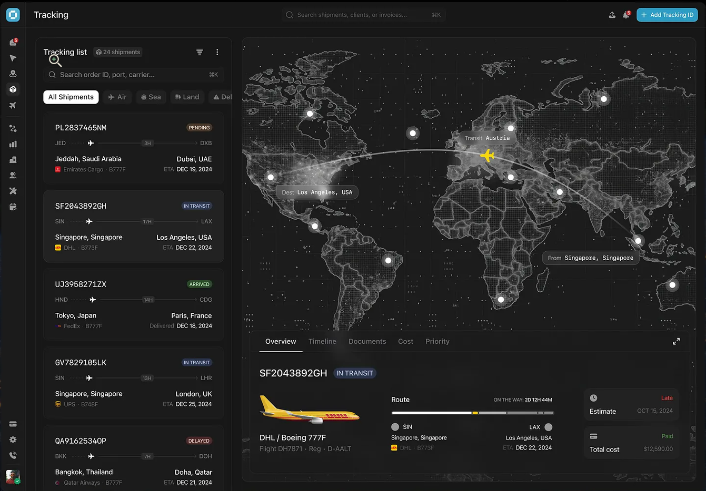

# CargoTrace — Design Language (DESIGN.md)

> **Binding visual specification.** Every screen is built to this document and checked against it before a milestone closes (RULES.md R8.5).
> **Sources:** the reference dashboard (`design/reference-tracking-dashboard.png`), the `unslop` skill, and the brief's stack mandate [S14]. Where the reference shows something outside CargoTrace's scope, this document names the replacement — the reference is a **quality bar**, not a feature list (see §14 Scope mapping).



---

## 1. Direction

- **Product.** CargoTrace — a shipment-visibility platform that operators watch all day and customers check occasionally [S3].
- **Character.** Exact, calm, night-shift operational. An ops room at 2 a.m.: everything legible, nothing shouting.
- **World.** Freight and aviation after dark — air waybills, station codes, radar screens, tarmac lights. Neutrals are cool graphite; the only warm note is the amber-yellow of a live aircraft marker.
- **Moments.** Two, and only two: (1) the live world map with the glowing route arc and the current-position marker; (2) the shipment timeline. Charts and stat cards stay quiet.
- **Signature.** Operational data is always set in mono — tracking numbers, station codes, durations, ETAs, timestamps, figures. If it is data the ops team reads at a glance, it is `IBM Plex Mono` with tabular figures. Nothing else gets mono.

---

## 2. Design tokens

Tokens are defined once as CSS variables and mapped into the Tailwind theme (Tailwind v4 `@theme` or v3 `tailwind.config` — whichever version the project installs; verify at build time per R1.2).

### 2.1 Color — surfaces and text (one cool graphite ramp)

| Token | Value | Use |
|---|---|---|
| `--bg-base` | `#0A0B0D` | page background |
| `--bg-rail` | `#08090A` | icon sidebar rail |
| `--bg-surface` | `#101216` | panels, cards, list rows |
| `--bg-raised` | `#16181D` | inputs, hover, selected states |
| `--bg-overlay` | `#1B1E24` | popovers, dropdowns, modals, map popups |
| `--border` | `rgba(235,238,245,0.08)` | hairlines everywhere |
| `--border-strong` | `rgba(235,238,245,0.14)` | focused inputs, active rows |
| `--text-primary` | `#E8EAEE` | headings, values |
| `--text-secondary` | `#9BA0AA` | body, labels |
| `--text-muted` | `#5D626C` | meta, placeholders, attribution |

Depth comes from surface steps and hairlines, never from shadows. One exception: popovers and the map's bottom panel may carry `0 8px 24px rgba(0,0,0,0.5)` so they read as floating. The map's bottom detail panel may use a subtle translucent surface (`rgba(16,18,22,0.88)` + `backdrop-blur(8px)`) — that is the only glass effect in the product.

### 2.2 Color — accent and live

| Token | Value | Use |
|---|---|---|
| `--accent` | `#3B82F6` | active states, selection, focus rings, links |
| `--accent-strong` | `#2563EB` | primary button background (white text = 5.2:1 contrast) |
| `--live` | `#FACC15` | **only** the current-position marker and the route-progress knob |

The accent appears rarely: the primary action, the selected row/card, the active tab underline. The yellow `--live` appears in exactly two places (map marker, progress knob) — it is the signature warm note from the reference, not a second brand color.

### 2.3 Color — status semantics

Badges: tinted background (12% of the hue), text in the hue's 300–400 step, no border, `10px` uppercase, weight 500, letter-spacing `0.04em`, padding `2px 8px`, radius `4px`. Uppercase here is a deliberate exception to sentence case — status chips are instrument markings, exactly as in the reference.

| Meaning | Text | Background tint |
|---|---|---|
| `CREATED` | `#A8ADB8` | neutral 12% |
| `BOOKED` | `#FCD34D` | amber 10% |
| `PICKED UP` | `#2DD4BF` | teal 10% |
| `IN TRANSIT` | `#60A5FA` | blue 10% |
| `DELIVERED` | `#34D399` | green 10% |
| On time | `#34D399` | outline style (hairline border, transparent bg) |
| Delay LOW / severity LOW | `#FCD34D` | amber 10% |
| Delay MEDIUM / severity MEDIUM | `#FB923C` | orange 10% |
| Delay HIGH / severity HIGH | `#F87171` | red 10% |
| Exception `OPEN` | `#F87171` | red 10% |
| Exception `INVESTIGATING` | `#FCD34D` | amber 10% |
| Exception `RESOLVED` | `#34D399` | green 10% |
| Error text/banner | `#F87171` | red 8% |

These sets come from DATA_MODEL §4 (`CREATED/BOOKED/PICKED_UP/IN_TRANSIT/DELIVERED` [S6], delay classes [S8], exception lifecycle [S8]). The reference's `PENDING/ARRIVED` labels are **not** CargoTrace statuses and are never used.

### 2.4 Typography

- **UI:** IBM Plex Sans, weights 400/500/600 (`@fontsource/ibm-plex-sans`). Chosen deliberately: it has an engineered, instrument-panel character that fits the world, and pairs natively with the mono face. Hierarchy comes from size and color, not weight; 600 is reserved for page titles and figures.
- **Data:** IBM Plex Mono, 400/500 (`@fontsource/ibm-plex-mono`) — the signature face (§1).
- Scale: `10` (badges) · `11` (chip meta, table headers) · `12` (meta, axis labels) · `13` (dense body, list rows) · `14` (body) · `16` (card titles) · `20` (section titles) · `24` (page titles) · `30` (dashboard figures).
- Sentence case everywhere except status badges (§2.3). No italic, no negative tracking below 20px, `tabular-nums` on all figures.

### 2.5 Spacing, radius, elevation

- 4px grid throughout. Cards `padding 16–20`; panels `16`; page edges `24`; list row gap `8`; sidebar nav rows `32–36` tall with `2–4` between.
- Radius: controls/inputs `8`, buttons `8`, cards `12`, panels `14`, modals `16`, badges `4`, filter chips and map labels `999` (pill).
- Hairline borders are the default separator; elevated surfaces get the single popover shadow (§2.1).

### 2.6 Icons

One set only: **Lucide**, 16px, stroke 1.5, in the color of their text role (secondary/muted) — matching the thin line icons in the reference. No emoji anywhere in the UI [R9]. Via the Blade Lucide package (§13).

---

## 3. App shell

```
┌──┬──────────────────────────────────────────────┐
│R │ topbar 60px: title · search(⌘K) · bell · CTA │
│a ├──────────┬───────────────────────────────────┤
│i │  380px   │          content / map            │
│l │  panel   │                                   │
└──┴──────────┴───────────────────────────────────┘
```

- **Icon rail** `56px`, fixed, `--bg-rail`: top group (Dashboard, Tracking, Exceptions), middle group (Carriers, Locations, Users*, Audit log* — *admin only [S5]), bottom (Settings, avatar). Active item: `--bg-raised` pill + accent icon. Icons 20px, labels as tooltips.
- **Topbar** `60px`, hairline bottom border: page title left (20/500); centered global search (max-width 480, placeholder "Search shipments, tracking IDs, customers…", `⌘K` kbd chip — focus shortcut in vanilla JS); right: bell with unread count (small red badge, mono) [S10] and one primary button ("New shipment" — the reference's "+ Add Tracking ID"). The reference's import/export icon is dropped: no such feature in scope (§14).
- Content fills the viewport; the app never shrinks into a centered column.

---

## 4. Core components

### 4.1 Shipment card (the workhorse — left panel of the tracking screen)

```
┌────────────────────────────────────────────┐
│ SF2043892GH                      IN TRANSIT│  row 1: mono number 14/500 · badge right
│ SIN ─ ─ ✈ ─ 17H ─ ─ LAX                    │  row 2: mono codes, dotted connector, plane icon, mono duration
│ Singapore, Singapore      Los Angeles, USA │  row 3: cities, 13px secondary, justified apart
│ ● DHL · B773F               ETA DEC 22     │  row 4: carrier dot + name · equipment (12 muted) · ETA mono right
└────────────────────────────────────────────┘
```

- Surface `--bg-surface`, radius 12, hairline border, padding 16. Gap between cards 8.
- **Selected state:** `--bg-raised` + `--border-strong`; hover: `--bg-raised` at 50%.
- Carrier is a small colored dot + fictional name — never real brand logos (§14).
- The whole card is clickable; selecting it highlights the route on the map and loads the detail panel.

### 4.2 Route progress bar (detail panel, from the reference)

Label row: `Route` (13 secondary) · right-aligned mono `ON THE WAY: 2D 12H 44M` (12 mono muted). Bar: 4px track `--bg-raised`, filled portion `--text-primary` up to current position, `--live` 8px knob at the position. Endpoints: origin dot + code + city (left), destination dot + code + city (right, right-aligned). Carrier line and ETA mono underneath.

### 4.3 Stat cards (dashboard)

A label (12 secondary), a figure (30 mono, tabular), one contextual line (12 muted, e.g. "2 more than yesterday" only if real data backs it [R1.6]). No icons, no sparklines, no decoration. Figures come from real queries [S10].

### 4.4 Timeline (shipment detail / Timeline tab) — moment #2

Vertical rail on the left: dots connected by a hairline. Normal events = hollow dot; exception events = red filled dot with a 12px alert icon [S7 "bedakan event normal dan exception"]. Each entry: mono timestamp (`Dec 18 · 14:32`), location (13 primary), description (13 secondary), event type badge. The latest valid event (current location [S7]) carries the `--live` dot and a subtle pulse (the only looping animation in the product — it marks live data). Chronological order [S7].

### 4.5 Badge / chip / kbd / banner

- `x-badge`: §2.3 spec.
- `x-chip`: pill filter (11px), inactive = `--bg-surface` + secondary text + hairline; active = `--bg-raised` + primary text.
- `x-kbd`: mono 10px in a `--bg-raised` box with hairline, for ⌘K.
- `x-banner`: inline error/info banner (13px, tinted bg) — used for external API failures [S9].

### 4.6 Tables (admin: users, carriers, locations, audit log)

Header 11px muted, rows 44px with hairline separators, values 13px, numeric/ID columns mono. Server-side pagination footer: "Showing 1–15 of 52" (12 muted) + prev/next [S10]. Audit log renders actor, action, entity, time in mono columns [S10].

### 4.7 Forms

Inputs: `--bg-raised`, radius 8, hairline border → `--border-strong` on focus + 2px accent focus ring. Labels 12 secondary above. Errors: red 13px below the field. Everything validated server-side [S16]; the UI only mirrors it.

---

## 5. Screens

| Screen | Serves | Layout |
|---|---|---|
| Login / Register | auth [S12] | centered 400px card on `--bg-base`, wordmark, no decoration |
| Dashboard | FR-6 [S10] | stat row (Total, In transit, Delivered, Delayed, Open exceptions) + shipments-by-status and by-carrier bars + delay/exception rate bars; role-scoped [S5] |
| Tracking (home for operators/admin) | FR-2/3/4/7 [S7–S10] | §3 shell: 380px list + map + bottom detail panel |
| Shipment detail (expanded) | FR-1/2/3 [S6–S8] | full page: header (number, badge, actions), Overview (fields + progress + estimate card), Timeline, Exceptions tabs |
| Exceptions list | FR-3 [S8] | table with type/severity/status filters, resolution actions for operator/admin |
| Admin: Users / Carriers / Locations / Audit | [S5, S10] | §4.6 tables + create/edit modals |
| Notifications | FR-8 [S10] | topbar dropdown + full list page; unread dot, "Mark all read" |
| Customer home | [S5] | same shell, Tracking screen scoped to own shipments; no admin rail items |

### 5.1 Tracking screen detail

- **List panel** `380px`: header ("Tracking list" + mono count chip "24 shipments" + filter + kebab), search input with `⌘K`, chip row, scrollable card list (§4.1).
- **Chip row** (maps to real S10 filters): `All Shipments` · `In transit` · `Delayed` · `Exceptions` — the last one filters shipments with an open exception `[DESIGN]`; if kept, it is added to API_SPEC §3 first (R1.4). No Air/Sea/Land chips — mode is not an S10 filter.
- **Map area**: fills remaining space; bottom detail panel overlays it (height 300px, expand icon → full `/shipments/{id}` page).
- **Detail panel tabs**: `Overview` · `Timeline` · `Exceptions` (active tab: primary text + 2px accent underline). The reference's `Documents`, `Cost`, `Priority` tabs are out of scope (§14).

### 5.2 Estimate card (delay rule made visible, [S8])

```
┌───────────────────────────────┐
│ ◔ Estimated arrival     HIGH  │   clock icon, mono date, delay badge
│ DEC 26, 2024 · 14:30          │
│ 30H 12M behind expected       │   the reason + values used [S8]
│ Expected DEC 25, 08:00        │
└───────────────────────────────┘
```
On-time variant shows a green outline "On time" tag and the expected date. The reference's "Total cost / Paid" card is **not built** — payments are out of scope [S4].

---

## 6. Map design (moment #1, [S9])

- **Tiles:** CARTO Dark Matter (`https://{s}.basemaps.cartocdn.com/dark_all/{z}/{x}/{y}{r}.png`) — OSM data, dark style, matches the reference's night map. Attribution "© OpenStreetMap contributors © CARTO" visible bottom-right, muted but readable [S9 "attribution + tile policy"]. Fallback: standard OSM tiles. `[DESIGN]`
- **Markers:** origin = 8px hollow white ring; destination = 8px filled white; tracking points = 4px white at 60%; **current position** = 18px yellow (`--live`) aircraft glyph rotated to bearing with a soft glow — the reference's signature element.
- **Route:** great-circle arc (interpolation helper in vanilla JS, ~30 lines — no extra library), 1.5px `rgba(255,255,255,0.35)`.
- **Labels:** pill chips with hairline (`From Singapore, Singapore`, `Dest Los Angeles, USA`) anchored near endpoints; mono codes inside.
- **Popups** [S9]: `--bg-overlay`, radius 8, status badge + mono time + location.
- **Focus behavior:** selecting a card flies the map to the route bounds (300ms) and dims every other shipment's dots to 40%.
- **Failure:** tiles failing → base map message banner; coordinates missing → marker silently omitted; external geocoding failing → banner with retry, map still renders [S9].

## 7. Charts (Chart.js, [S14])

- Global defaults: Plex Sans 11px, axis text `--text-muted`, grid `rgba(235,238,245,0.06)`, tooltips styled as `--bg-overlay` pills, no chart borders.
- Bars: neutral ramp steps of the graphite ramp; **one accent** on the leading value (largest carrier, most-common status) [unslop].
- Dashboard charts are horizontal thin bars (comparison), rate cards are plain progress bars (single goal) [unslop: pick the chart for the data]. No rainbow series, no donuts for decoration, no second oversized chart.

## 8. Data formatting

- Tracking numbers, station codes, durations, ETAs, timestamps, figures → mono, `tabular-nums`, uppercase.
- Dates: `Dec 22, 2024`; timestamps: `Dec 18, 2024 · 14:32`; durations: `17H` or `2D 12H 44M`; money: never (no financial features [S4]).
- Seed data looks real: fictional carriers ("Meridian Air Cargo", "Nusantara Freight"), plausible codes and schedules [S4]. Real carrier brands (DHL, Emirates, FedEx…) from the reference are never used, in UI or seed data.

## 9. Loading / empty / error states

- Loading: static skeleton blocks (`--bg-raised`), no shimmer.
- Empty: one line of plain copy + one quiet action ("No shipments match this filter — Clear filters"). No illustration walls, no emoji.
- Error: `x-banner` with a retry action where retry exists (external API [S9]); form errors inline (§4.7).

## 10. Motion

- 150–200ms transitions on color, background, border, opacity, transform — named transitions only (`transition-colors` etc.), one easing curve.
- Allowed: panel slide-up on detail open, map `flyTo`, changed numbers tweening, the 2s pulse on the live position dot and timeline current-event dot (live data semantics).
- Never: hover scale on cards, looping decorative motion, animated layout properties, entrance choreography per card.

## 11. Accessibility

- Focus: visible 2px `--accent` ring on every interactive element; `⌘K` focuses search; list is arrow-key navigable.
- Contrast: text roles pass on their surfaces; accent-on-white text uses `--accent-strong` or darker.
- Status is never color-only: every badge carries its text label [unslop/WCAG].
- The map is operable by keyboard via the shipment list (selection drives the map); map controls remain reachable.

## 12. Anti-slop checklist (checked per screen before milestone close)

- [ ] Quiet chrome: no gradients, glows, or colored shadows on surfaces/buttons/labels (glow allowed only on the live map marker)
- [ ] One accent in view; `--live` yellow only in its two legal places
- [ ] No emoji; one icon set, one size, one stroke
- [ ] Operational data in mono; numbers in one format; nothing reads as a template
- [ ] Badges carry text, not color alone; sentence case except badges
- [ ] No looping motion except the live-dot pulse; no hover scaling
- [ ] Every number on screen traces to a database query [S10]; every status to DATA_MODEL §4 [S6, S8]
- [ ] Swap test: replace the name — does this still only look like CargoTrace? If yes for any other product, push the signature (mono data treatment + live map) harder

## 13. Implementation mapping (library-first, R4)

| Concern | Library / approach |
|---|---|
| Styling | Tailwind CSS via Vite; tokens as CSS variables mapped into the theme [S14] |
| Components | **Blade components**: `x-badge`, `x-chip`, `x-shipment-card`, `x-progress-route`, `x-stat-card`, `x-timeline`, `x-map`, `x-kbd`, `x-banner`, `x-table`, `x-pagination`, `x-modal`, `x-stat-estimate` — no copy-pasted partials |
| Icons | Blade Lucide package (e.g. `mallardduck/blade-lucide-icons` — verify current package at build time via Context7 per R1.2) |
| Fonts | `@fontsource/ibm-plex-sans` + `@fontsource/ibm-plex-mono`, imported through Vite |
| Map | `leaflet` (npm) + CARTO Dark tiles; vanilla JS init module (`resources/js/map.js`) [S9] |
| Charts | `chart.js` (npm), global defaults set once in `resources/js/charts.js` [S14] |
| Interactions | **Vanilla JS ES modules** per screen (`tracking.js`, `dashboard.js`…) + `fetch` helpers [S14]. No React/Vue/Livewire/Inertia/Alpine — the brief mandates vanilla JS + Fetch, and adding a framework violates the stack [S14, R5] |
| Motion | Tailwind transition utilities; map via Leaflet's animated `flyTo` |

## 14. Scope mapping — reference element → CargoTrace decision

| In the reference | Decision | Why |
|---|---|---|
| Statuses PENDING / ARRIVED / IN TRANSIT / DELAYED | Replaced by `CREATED / BOOKED / PICKED UP / IN TRANSIT / DELIVERED` badges + separate delay chip + exception badges | Brief's status set [S6]; "delayed" is a computed flag, not a status [S8] |
| `Documents` / `Cost` / `Priority` tabs | Dropped; tabs are Overview / Timeline / Exceptions | Document management and payments are not in scope; payments explicitly out [S4] |
| "Total cost $12,590 · Paid" card | Dropped; replaced by the Estimate card (§5.2) | No financial features [S4] |
| "+ Add Tracking ID" button | "New shipment" (operator/admin only) | Our domain language [S6]; role-gated [S5] |
| Real carrier brands (DHL, Emirates, FedEx, UPS, Qatar) | Fictional carriers with colored-dot monograms | Synthetic but realistic data [S4]; no trademark use |
| Import/export icon in topbar | Dropped | No such feature in the brief |
| Air / Sea / Land chips | Replaced by All / In transit / Delayed / Exceptions `[DESIGN]` | S10 defines the filter set; mode is not one of them |
| Dark pointillist custom basemap | CARTO Dark Matter (OSM data) via Leaflet | Brief mandates Leaflet + OSM [S9]; dark style preserved, policy-compliant |
| ⌘K search bars | Kept, implemented in vanilla JS | Fits FR-7 [S10] and the stack [S14] |
