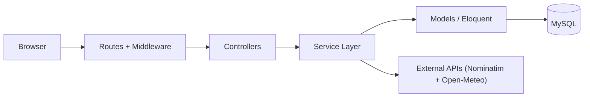
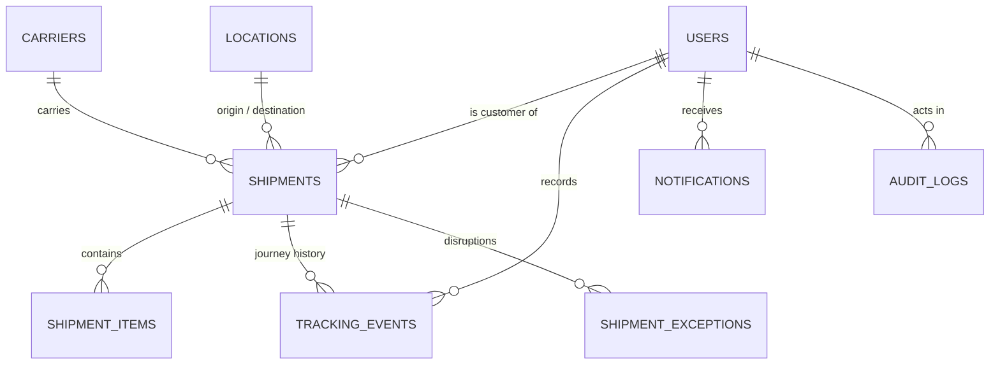

# CargoTrace

Real-time supply chain and shipment visibility web application for the
Web Programming 2 final project (UAS). Laravel 12 + MySQL 8, Blade views,
Sanctum API tokens, Leaflet + OpenStreetMap, Chart.js.

Live deployment: **http://43.173.52.180:3000**

## What it does

- **Roles & authorization** — Admin, Logistics Operator, Customer. Every
  route is authorized server-side; customers only ever see their own
  shipments (policy + query scoping, verified by automated tests).
- **Shipment lifecycle** — CREATED → BOOKED → PICKED_UP → IN_TRANSIT →
  DELIVERED (terminal). Only the next status is allowed; skipping a status
  is rejected with 422. Tracking events are append-only and must be in
  chronological order.
- **Delay rule** — deterministic, configurable: delay ≤ low threshold =
  LOW, ≤ high threshold = MEDIUM, beyond = HIGH. Default 6 h / 24 h
  (see Group scenario).
- **Exceptions** — the brief's six types (CUSTOMS_HOLD, WEATHER_DELAY,
  PORT_CONGESTION, DAMAGED, MISROUTED, DOCUMENTATION_ISSUE) with severity
  and OPEN → INVESTIGATING → RESOLVED, detection and resolution times.
- **Map** — Leaflet + OpenStreetMap tiles with attribution, origin /
  destination markers, transit stops and the corridor route. No API key.
- **External integrations** — Nominatim geocoding and Open-Meteo weather
  through the Laravel HTTP Client (5 s timeout, errors and empty responses
  handled, fallback values labelled "cached"). Weather is informational
  only and is never used as delay evidence.
- **Dashboard** — real data from the database: counts by status, on-time
  vs delayed by carrier, overdue unpaid-style watch list, recent activity.
- **Search & filter** — reference, status, carrier, origin, destination,
  date range, delay status, sorting, server-side pagination (10 per page).
- **Notifications & audit log** — in-app notifications (unread badge,
  mark read / read all) and an audit trail with actor, action, time,
  entity and delta.
- **REST API** — full CRUD under `/api/v1` with Sanctum Bearer tokens,
  one JSON envelope, 200/201/401/403/404/422. Postman collection in
  `postman/CargoTrace.postman_collection.json` (login auto-saves the token).

## Tech stack

| Layer | Choice |
| --- | --- |
| Language / framework | PHP 8.2+ (8.3 on the VPS), Laravel 12 |
| Database | MySQL 8 (Docker, localhost-only) |
| Auth | Laravel Sanctum personal access tokens (API) + session login (web) |
| Views | Blade + Tailwind via CDN, no build step |
| Map | Leaflet 1.9.4 + OpenStreetMap tiles |
| Charts | Chart.js 4.4.1 |
| Fonts | Plus Jakarta Sans + JetBrains Mono (Google Fonts) |
| Tests | PHPUnit 11 via `php artisan test` (SQLite in-memory) |

Business rules live in one place each: `ShipmentLifecycleService`
(transitions + chronology), `DelayClassifierService` (delay rule),
`ExternalTelemetryService` (geocoding + weather), `IndonesianPortCatalog`
(presets + 38 provinces). Thresholds live in `config/cargotrace.php`
and `.env` (`CARGOTRACE_*`), never in code.



## Data model



### Data dictionary

| Table | Key columns | Notes |
| --- | --- | --- |
| users | id, name, email (unique), password (bcrypt), role (ADMIN / LOGISTICS_OPERATOR / CUSTOMER) | Sanctum tokens in `personal_access_tokens` |
| carriers | id, name, code (unique), service_type (SEA / AIR / ROAD), is_active | |
| locations | id, name, code (unique), city, country, province, latitude, longitude | WGS84 coordinates, indexed for map queries |
| shipments | id, shipment_number (unique), customer_id (FK users), carrier_id (FK), origin_location_id / destination_location_id (FK locations), current_status, cargo_type, weight_kg, volume_m3, expected_departure_at, expected_arrival_at, estimated_arrival_at, archived_at (nullable) | Status enum CREATED/BOOKED/PICKED_UP/IN_TRANSIT/DELIVERED; DELETE archives instead of removing the row |
| shipment_items | id, shipment_id (FK), description, quantity, weight_kg, volume_m3 | Cargo manifest, at least one item per shipment |
| tracking_events | id, shipment_id (FK), user_id (FK), status, event_time, location, notes | Append-only; event_time must be after the previous event |
| exceptions | id, shipment_id (FK), type (6 brief types), severity (LOW/MEDIUM/HIGH), status (OPEN/INVESTIGATING/RESOLVED), detected_at, resolved_at (nullable) | resolved_at is stamped automatically on RESOLVED |
| notifications | id, user_id (FK), shipment_id (FK, nullable), title, message, is_read | In-app only |
| audit_logs | id, user_id (FK, nullable), action, entity_type, entity_id, delta (JSON), created_at | Actor, action, time, entity + change delta |
| scenario_configs | id, name, low_threshold_hours, high_threshold_hours, route, primary_exception, kpi | One active row; edited from the Scenario page |
| sessions / cache / jobs | Laravel framework tables | Session driver and cache store are `database` by default |

## Setup

Requirements: PHP 8.2+ with mbstring, xml, sqlite3, mysql, curl, zip,
bcmath, intl; Composer 2; Docker (for MySQL) or a local MySQL 8 server.

```bash
git clone <repository-url> && cd cargotrace
composer install
cp .env.example .env            # set DB_PASSWORD to your MySQL password
php artisan key:generate

# MySQL 8 (Docker, localhost-only, named volume)
docker run -d --name cargotrace-db --restart unless-stopped \
  -e MYSQL_ROOT_PASSWORD=<root-password> \
  -e MYSQL_DATABASE=cargotrace \
  -e MYSQL_USER=cargotrace -e MYSQL_PASSWORD=<app-password> \
  -p 127.0.0.1:3306:3306 -v cargotrace-mysql:/var/lib/mysql mysql:8.0

php artisan migrate --seed      # schema + demo data
php artisan serve --host=0.0.0.0 --port=3000   # http://localhost:3000
```

No Node build step: Tailwind, Leaflet and Chart.js load from CDN.

### Demo accounts (password: `password123`)

| Role | Email |
| --- | --- |
| Administrator | admin@cargotrace.io |
| Logistics Operator | operator@cargotrace.io |
| Customer | customer@cargotrace.io |
| Customer | dewi@cargotrace.io |

The seeder builds a Southeast Asia → Europe & Indonesian regional
corridor: 4 carriers (SEA/AIR/ROAD), 12 port locations with WGS84
coordinates, 14 shipments across every status (on-time and delayed),
34 tracking events, 6 exceptions covering all six brief types, and 4
notifications. Newly registered accounts start as Customer with 0
shipments and can request new bookings.

## Tests

```bash
php artisan test        # 29 tests, 137 assertions: auth, CRUD,
                        # authorization, transitions, chronology, ETA/delay
                        # rule, exceptions, API, map data
```

The suite runs on SQLite in-memory for speed; the application itself
runs on MySQL 8. Negative cases are covered too: invalid logins,
invalid status transitions, out-of-order events, foreign-resource
access (customer isolation), and geocoding timeouts, errors, and empty
responses.

## API

`postman/CargoTrace.postman_collection.json` covers every endpoint —
set `{{base_url}}`, run **Login** (the token is captured automatically),
and explore. Highlights:

```
POST   /api/v1/register              POST   /api/v1/login
POST   /api/v1/logout                GET    /api/v1/user
GET    /api/v1/shipments?status=&delayed=&sort=&q=&date_from=&date_to=
POST   /api/v1/shipments             GET    /api/v1/shipments/{id}
PUT/PATCH /api/v1/shipments/{id}     DELETE /api/v1/shipments/{id}   (archive)
GET    /api/v1/shipments/map         GET    /api/v1/shipments/{id}/tracking
POST   /api/v1/shipments/{id}/tracking-events
GET    /api/v1/shipments/{id}/exceptions
POST   /api/v1/shipments/{id}/exceptions
PATCH  /api/v1/exceptions/{id}       GET/POST /api/v1/carriers
GET    /api/v1/locations             POST   /api/v1/locations
GET    /api/v1/locations/catalog     GET    /api/v1/health
```

Errors use one JSON envelope (`status` + `message`, validation failures
add field `errors`), validation failures return 422, unauthenticated
access 401, forbidden 403, and unknown or foreign-owned resources 404.
Customers may create shipments (forced under their own id, status
CREATED); only Admin / Logistics Operator may advance status, add
tracking events, raise or resolve exceptions, or create carriers and
locations.

## Group scenario

Delay thresholds, route, primary exception, and KPI come from
`config/cargotrace.php` + `.env` (`CARGOTRACE_*`) and from the
**Scenario & users** page (admin only) — never from code. Presets match
the brief's slide 23 examples:

| Preset | Route | Low / High | Primary exception | KPI |
| --- | --- | --- | --- | --- |
| DEFAULT | SEA → Europe | 6 h / 24 h | CUSTOMS_HOLD | On-Time Delivery Rate |
| GROUP_A | SEA → Europe | 12 h / 24 h | CUSTOMS_HOLD | On-Time Delivery Rate |
| GROUP_B | Asia → North America | 18 h / 36 h | WEATHER_DELAY | Average Delay Duration |
| GROUP_C | SEA → Australia | 24 h / 48 h | DOCUMENTATION_ISSUE | Exception Resolution Time |

Pick the preset for your group on the Scenario page, or set a custom
rule (high threshold must be greater than low). Changing the rule writes
a `SCENARIO_UPDATED` audit entry.

## Deployment

The live deployment runs on a VPS (Ubuntu 24.04) as a systemd service:

- MySQL 8 in Docker (`cargotrace-db`, `mysql:8.0`, volume
  `cargotrace-mysql`, bound to 127.0.0.1:3306 only).
- App: `cargotrace.service` runs `php artisan serve --host=0.0.0.0
  --port=3000` from the repo directory, `Restart=always`,
  `APP_ENV=production`, `APP_DEBUG=false`.
- Secrets live only in the server `.env` (never committed; see
  `.env.example` for the full list). No secrets are committed to the
  repo.

## Known limitations & future work

- Notifications are in-app only; external email/webhook delivery is future work.
- Live weather telemetry (Open-Meteo) is strictly informational and is
  explicitly **not** used as delay evidence (delays are determined solely
  by `estimated_arrival_at` vs `expected_arrival_at`); when the API is
  unreachable the page shows fallback values labelled "cached".
- `DELETE /api/v1/shipments/{id}` archives the shipment (`archived_at`)
  instead of removing it, so history and audit references stay intact;
  archived shipments are excluded from lists.
- Positions on the map are port coordinates and corridor waypoints, not
  live GPS positions of vehicles or vessels.
- The app is served with `php artisan serve` behind no reverse proxy;
  a production setup would use nginx + PHP-FPM and HTTPS.

## Attribution

All libraries, fonts, icons, tile providers, and external sources are
recorded in [ATTRIBUTION.md](ATTRIBUTION.md), as the project brief
requires.
