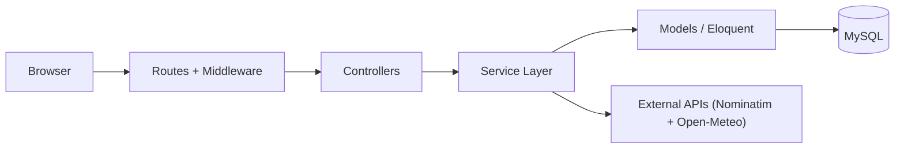
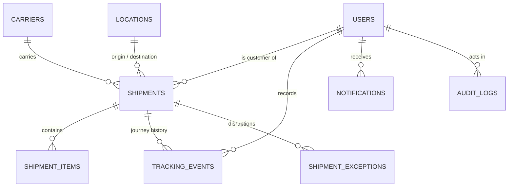

# CargoTrace

Global shipment visibility and tracking for a logistics operation — the
final project for Web Programming 2 (UAS).

Logistics teams lose track of shipments because the information lives in
phone calls, spreadsheets, and carrier portals. Customers cannot see
where their cargo is. Delays surface too late. CargoTrace puts every
shipment in one place: a tracked lifecycle, a historical journey
timeline, a live world map, deterministic delay detection, exception
management, and an operations dashboard — with a REST API for programmatic
access.

## Features

- **Shipment lifecycle & 1-click progression** — `CREATED → BOOKED → PICKED_UP → IN_TRANSIT →
  DELIVERED`, transitions validated server-side against a single allowed
  map (`DELIVERED` is terminal), with a 1-click `Advance → Next Status` action for operators.
- **Multi-leg corridor & Planned Transit Stops** — append-only tracking timeline (never overwritten),
  chronological validation, optional **Intermediate Transit Stop / Via Hub** at booking/edit time
  (`Origin ━━▶ Transit Stop ╌╌▶ Destination`), and great-circle Haversine distance + ETA calculator.
- **38 Indonesian Provinces & Regional Hub Catalog** — searchable registry of 110+ Indonesian
  Kabupaten/Kota/Ports (Aceh: Bireuen, Krueng Geukuh, Lhokseumawe, Sabang, Malahayati, etc.) and
  international maritime/air hubs with province filtering and 1-click activation.
- **ETA & delay rule** — deterministic classification (LOW / MEDIUM /
  HIGH) from configurable thresholds shown with the reason and values used.
- **Exceptions** — the six brief-mandated types with an OPEN →
  INVESTIGATING → RESOLVED lifecycle and server-stamped resolution.
- **World map & Dual External APIs** — Leaflet with adaptive White/Dark Esri/OSM tiles, great-circle routes,
  live position markers, popups; geocoding through **OpenStreetMap Nominatim** and live marine/corridor
  weather via **Open-Meteo** with explicit timeout/error/fallback handling.
- **Official Printable Bill of Lading (e-B/L)** — 1-click printable Waybill & itemized Cargo Manifest
  with auto-synced manifest weight/volume totals.
- **Dashboard & Customer Portal** — real database numbers (0-shipment clean state for new registrations),
  role-scoped analytics, Customer self-service shipment booking request (`CREATED`), and Waybill Resi
  linking (`Link & Track Resi`).
- **Dual Theme Design System** — **White Mode** (`#FFFFFF`) default with instant **Dark Mode** (`#080B0C`)
  toggle and `#C6F432` industrial chartreuse accents engineered for WCAG AAA readability.
- **Search & filter** — reference, status, carrier, origin, destination,
  delay, date range; searchable Port Locations (by province/country), Carriers, and Audit Log.
- **Notifications** — in-app bell and page for status changes and
  exception lifecycles on shipments the user may see.
- **Audit log** — actor, action, entity, and changed values for every
  important change; administrator only.
- **REST API** — Sanctum tokens, JSON envelope, 200/201/401/403/404/422
  semantics, Postman collection included.

### Roles & Login Credentials

Use the following seeded accounts on `/login` (no quick-demo bypass buttons are exposed in the UI):

| Role | Name | Email | Password | Permissions |
| --- | --- | --- | --- | --- |
| **Administrator** | Aria Wibowo | `admin@cargotrace.test` | `password` | Full access: users & delay rules, carriers, port locations, all shipments, audit log |
| **Logistics Operator** | Bimo Santoso | `operator@cargotrace.test` | `password` | Create/update shipments, 1-click advance status, append tracking checkpoints, raise & resolve exceptions |
| **Customer** | Citra Hapsari | `customer@cargotrace.test` | `password` | View own shipments, request new shipment bookings, link & track resi, print Bill of Lading, view trajectory map & notifications |

Authorization is enforced server-side on every route and `/api/*` endpoint; the interface mirrors what the server allows.

## Tech stack

PHP 8.3+ · Laravel 12 · Blade · Tailwind CSS v4 · TypeScript / React +
Fetch · MySQL 8 · Eloquent + migrations/seeders · Laravel Sanctum ·
Laravel HTTP Client · Leaflet + Esri/OSM tiles · Chart.js · Node Test / PHPUnit.

## Architecture

HTTP handling stays separate from business logic. Controllers validate
input; services own the rules and the transactions.



Business services: `ShipmentService`, `TrackingService`, `EtaService`,
`ExceptionService`, plus `NotificationService`, `AuditLogger`, and
`GeocodingService`. Status transitions and the delay thresholds live in
one place each (`ShipmentStatus::allowedNext()`, `config/cargotrace.php`).

## Data model



Every relation and design decision is documented in the codebase and
defensible in review: unique shipment numbers and carrier/location codes,
restricting foreign keys, soft delete on shipments only, and indexes for
the list, timeline, and dashboard queries.

## Setup

Requirements: PHP 8.3+, Composer, Node 20+, Docker (for MySQL).

```bash
git clone <repository-url> && cd cargotrace
composer install
cp .env.example .env            # adjust credentials if needed
php artisan key:generate
docker compose up -d            # MySQL 8.4 on 127.0.0.1:3306
php artisan migrate --seed      # schema + demo data
npm install && npm run build
php artisan serve               # http://localhost:8000
```

### Demo accounts (password: `password`)

| Role | Email |
| --- | --- |
| Administrator | admin@cargotrace.test |
| Logistics Operator | operator@cargotrace.test |
| Customer | customer@cargotrace.test |

The seeder builds a Southeast Asia → Europe & Indonesian Regional corridor:
carriers across SEA/AIR/ROAD modes, real port locations with WGS84 coordinates
(including Aceh & 38 Indonesian provinces), 14 shipments across every status
including on-time and delayed estimates, believable tracking events, and
open, investigating, and resolved exceptions. Newly registered Customer accounts
start with 0 shipments and can request new bookings or link existing waybill numbers.

## Tests

```bash
npm test                # Domain business rules test suite (lifecycle, chronology, ETA delay rule, exceptions)
php artisan test        # 69 tests: auth, CRUD, authorization, transitions,
                        # chronology, ETA rule, exceptions, API, map data
```

The suite runs on SQLite in-memory for speed; the application itself runs
on MySQL 8. Negative cases are covered too: invalid logins, invalid status
transitions, out-of-order events, foreign-resource access, and geocoding
timeouts, errors, and empty responses.

## API

`postman/CargoTrace.postman_collection.json` covers every endpoint — set
`{{base_url}}`, run **Login** (the token is captured automatically), and
explore. Highlights:

```
POST   /api/register                 POST   /api/login
POST   /api/logout                   GET    /api/user
GET    /api/shipments?status=&delayed=&sort=...
POST   /api/shipments                GET/PUT/DELETE /api/shipments/{id}
GET/POST /api/shipments/{id}/tracking
GET/POST /api/shipments/{id}/exceptions
PATCH  /api/exceptions/{id}          GET/POST /api/carriers  GET/POST /api/locations
```

Errors use one JSON envelope (`message` + field `errors`), validation
failures return 422, unauthorized access 401/403, and unknown or
foreign-owned resources 404.

## Group scenario

Delay thresholds, route, primary exception, and KPI come from
`config/cargotrace.php` + `.env` (`CARGOTRACE_*`) — never from code. The
brief's example defaults are LOW ≤ 6 h, MEDIUM ≤ 24 h, HIGH beyond; the
lecturer's group values replace them without touching a line of PHP.

## Deployment

The app targets a standard PHP/Node host: set the environment variables from
`.env.example`, point `DB_*` at MySQL 8, run `php artisan migrate --seed`,
build assets with `npm run build`, and serve the application. Secrets stay in
the environment; nothing in the repository needs changing per host.

## Known limitations & future work

- Notifications are in-app only; external email/webhook delivery is future work.
- Live weather telemetry (Open-Meteo) is strictly informational and is explicitly **not** used as delay evidence (delays are determined solely by `estimated_arrival_at` vs `expected_arrival_at`).

## Attribution

All libraries, fonts, icons, tile providers, and external sources are
recorded in [ATTRIBUTION.md](ATTRIBUTION.md), as the project brief
requires.
